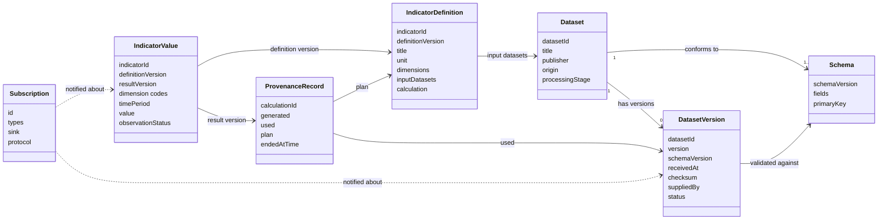

# 7 Data Structures

This section describes the base model of the Analytics Building Block: the objects that are visible through its interfaces, not how an implementation stores them. Seven objects are sufficient for the core, and almost every one of them has a counterpart in an existing standard.

The mandatory attributes form the **base model** with which an implementation must be compatible: it provides at least these attributes and may add others. Dataset and dataset version are named after DCAT 3 properties so that no separate vocabulary is created; this version does not require a DCAT output format. For each attribute, the column _Standard_ names its counterpart in the respective standard; attributes without an entry have no counterpart there and are defined by this specification.

The complete definitions, including request and response formats, are part of the [OpenAPI definition](8-service-apis.md).

## 7.1 Resource Model

Arrows mean "refers to", dashed lines are notifications. The **provenance record** is the node through which every value can be traced back to its definition version and its dataset versions.

## 7.2 Data Structures

Identifiers are case-sensitive strings. Points in time follow RFC 3339 in UTC. Checksums are SHA-256, written `sha256:<hex>`.

### 7.2.1 Dataset

**Description:** A described collection of data of one kind in the catalogue, for example _labour force and unemployed persons by region_. Corresponds to a DCAT 3 Dataset.

**Fields:**

| Name | Type | Required | Description | Standard |
| ---- | ---- | -------- | ----------- | -------- |
| `datasetId` | string | Y | Identifier of the dataset, lower case letters, digits and `_` | `dct:identifier` |
| `title` | string | Y | Title of the dataset | `dct:title` |
| `publisher` | string | N | Organisation that publishes the dataset | `dct:publisher` |
| `schema` | reference | N | Reference to the current schema and its `schemaVersion`; present once a schema is registered | `dct:conformsTo` |
| `origin` | enum | Y | `ORIGINAL` or `DERIVED`; set by the building block, not stated when the dataset is created | |
| `processingStage` | string | N | Processing stage from a code list defined by the installation | |
| `latestVersion` | reference | N | Latest valid dataset version | `dcat:hasCurrentVersion` |
| `versionsHref` | reference | Y | Reference to the paginated collection of all versions | `dcat:hasVersion` |
| `indicators` | array of references | N | Indicators that use this dataset | |

### 7.2.2 Dataset Version

**Description:** One delivered, immutable state of a dataset. Corresponds to DCAT 3 versioning via `dcat:version`.

**Fields:**

| Name | Type | Required | Description | Standard |
| ---- | ---- | -------- | ----------- | -------- |
| `datasetId` | string | Y | Identifier of the dataset | |
| `version` | integer | Y | Consecutive number per dataset, starting at 1; where a single identifier is needed it is written `<datasetId>:<version>` | `dcat:version` |
| `schemaVersion` | integer | Y | Version of the schema the delivery was validated against | `dct:conformsTo` |
| `receiptId` | string | Y | Identifier of the receipt of the delivery | |
| `suppliedBy` | string | Y | Supplying system | `prov:wasAttributedTo` |
| `receivedAt` | date-time | Y | Time of receipt | `dct:issued` |
| `checksum` | string | Y | SHA-256 checksum of the content, written `sha256:<hex>` | |
| `status` | enum | Y | `VALID` or `WITHDRAWN` | |
| `withdrawalReason` | string | N | Reason for the withdrawal; required if `status` is `WITHDRAWN` | |
| `contentAvailable` | boolean | N | `false` if the content was withdrawn or removed under an operational rule | |
| `withdrawnAt` | date-time | N | Time of the withdrawal | |

### 7.2.3 Schema

**Description:** The description of the fields of a dataset as a Table Schema according to Data Package Standard 2.0, against which every delivery is validated. Every change creates a new schema version. The schema version is assigned by the building block and is not part of the Table Schema document; it identifies the schema in the path (`/v1/datasets/{datasetId}/schema/{schemaVersion}`), in the dataset (`schema.schemaVersion`) and in every dataset version.

**Fields:**

| Name | Type | Required | Description | Standard |
| ---- | ---- | -------- | ----------- | -------- |
| `$schema` | URI | Y | Version of the Table Schema profile, e.g. `https://datapackage.org/profiles/2.0/tableschema.json` | Table Schema |
| `fields` | array | Y | Fields of the dataset | Table Schema `fields` |
| `fields[].name` | string | Y | Name of the field | Table Schema `name` |
| `fields[].type` | string | Y | Type of the field, e.g. `string`, `integer`, `year` | Table Schema `type` |
| `fields[].role` | enum | N | `identifier`, `time`, `measure` or `attribute`; derived by convention if missing | defined by this specification |
| `fields[].categories` | array | N | Permitted codes, as strings or as objects with `value` and `label`; source of the code list `<datasetId>.<field>` | Table Schema `categories` |
| `primaryKey` | array of strings | N | Key fields; used to derive field roles | Table Schema `primaryKey` |


**Open:** whether Data Package Standard 2.0 allows the additional property `role` is still to be checked. The draft also lists a _unit_ per field; Table Schema has no standard property for it, so how it is stated is still to be decided.


### 7.2.4 Indicator Definition

**Description:** The binding, versioned description of how an indicator is calculated from which data. Corresponds to an SDMX Data Structure Definition and Dataflow. Identifier and title belong to the indicator and are set when it is created; all other attributes belong to a definition version, so that a change of formula, unit, scope or dimensions creates a new definition version.

**Fields:**

| Name | Type | Required | Description | Standard |
| ---- | ---- | -------- | ----------- | -------- |
| `indicatorId` | string | Y | Identifier of the indicator | SDMX Dataflow ID |
| `definitionVersion` | string | Y | Version of the definition; immutable once published | SDMX `version` |
| `title` | string | Y | Title of the indicator | SDMX `name` |
| `unit` | string | Y | Unit of measure as a UCUM code, e.g. `%` | SDMX `UNIT_MEASURE` |
| `dimensions` | array of strings | Y | Dimensions; determined from the calculation, or stated explicitly if the language does not define the breakdown. Code lists come from the schemas of the input data | SDMX dimensions of the DSD |
| `frequency` | string | N | Frequency from `CL_FREQ`; otherwise derived from the time format | SDMX `FREQ` |
| `geoDimension` | string | N | The dimension that is geographic; output as JSON-stat role `geo` | |
| `codelists` | map | N | Reference to a shared code list per dimension, instead of the code list from the schema of the input data | |
| `inputDatasets` | array of strings | Y | Input datasets; determined by the building block from the calculation | |
| `calculation.language` | string | Y | Calculation language, e.g. `vtl-2.1`, `ossie-<version>`, or `x-…` for implementation-defined languages | |
| `calculation.expression` | string | Y | The calculation in that language | |
| `status` | enum | Y | `PUBLISHED` | |

### 7.2.5 Indicator Value

**Description:** A single value of an indicator for one combination of dimension codes and one time period. Corresponds to an SDMX Observation. Indicator values are delivered in JSON-stat 2.0 or CSV (see [Data Access](requirements/data-access.md)); this table describes the logical content.

**Fields:**

| Name | Type | Required | Description | Standard |
| ---- | ---- | -------- | ----------- | -------- |
| `indicatorId` | string | Y | Identifier of the indicator | SDMX Dataflow ID |
| `definitionVersion` | string | Y | Definition version the value was calculated with | SDMX `version` |
| `resultVersion` | string | Y | Result version the value belongs to; identical to the identifier of the calculation and the provenance record | |
| dimension codes | string per dimension | Y | Code of each dimension, e.g. region `R01` | SDMX dimensions, e.g. `REF_AREA` |
| `timePeriod` | string | Y | Time period in the SDMX time format, e.g. `2024`, `2024-Q1`, `2024-03` | SDMX `TIME_PERIOD` |
| `value` | number | N | The value; missing values are `null` or empty | SDMX `OBS_VALUE` |
| `observationStatus` | string | Y | Code from `CL_OBS_STATUS`, e.g. `A` (normal), `P` (provisional). In JSON-stat, a value without a status entry has the status `A`; in CSV it is stated in every row | SDMX `OBS_STATUS` |
| `unitMultiplier` | string | N | Code from `CL_UNIT_MULT` | SDMX `UNIT_MULT` |
| `basedOnWithdrawn` | boolean | N | `true` if the result version is based on a withdrawn dataset version | |

The provenance of a value is given through its result version.

### 7.2.6 Provenance Record

**Description:** The permanent record of how a result version or a derived dataset version was produced. It is kept even after the underlying data has been deleted or withdrawn and contains no personal data. Delivered as W3C PROV-O in JSON-LD.

**Fields:**

| Name | Type | Required | Description | Standard |
| ---- | ---- | -------- | ----------- | -------- |
| `@id` | string | Y | Identifier of the calculation, `urn:analytics:calculation:<calculationId>`; also identifies the result version | `prov:Activity` |
| `prov:generated` | reference | Y | The result version or derived dataset version produced | `prov:generated` |
| `prov:used` | array | Y | Input dataset versions: identifier `<datasetId>:<version>`, checksum (`checksum`), supplying system (`prov:wasAttributedTo`) and time of receipt (`dct:issued`) | `prov:used` |
| `prov:hadPlan` | reference | N | Definition version; only for indicator values | `prov:hadPlan` (via `prov:qualifiedAssociation`) |
| `prov:endedAtTime` | date-time | Y | Time the calculation finished | `prov:endedAtTime` |

### 7.2.7 Subscription

**Description:** The registration of a subscribing system for event types and a callback endpoint. Field names follow the CloudEvents Subscriptions API (working draft 0.1-wip); the structure is defined by this specification until a version 1.0 appears.

**Fields:**

| Name | Type | Required | Description | Standard |
| ---- | ---- | -------- | ----------- | -------- |
| `id` | string | Y | Identifier, assigned by the building block | CloudEvents Subscriptions `id` |
| `types` | array of strings | Y | Event types, e.g. `global.govstack.analytics.indicator.values.published` | CloudEvents Subscriptions `types` |
| `sink` | URI | Y | Callback endpoint | CloudEvents Subscriptions `sink` |
| `protocol` | string | Y | Always `HTTP` in the core | CloudEvents Subscriptions `protocol` |
| subscribing system | – | Y | The authenticated caller that created the subscription; not part of the request | |

## 7.3 Supporting Structures

The interfaces use further structures that are not part of the base model:

| Structure | Purpose | Defined in |
| --------- | ------- | ---------- |
| Data Package | Envelope of a delivery: `$schema`, `name`, `resources` with `path`, `format`, `encoding` and `dialect` | Data Package Standard 2.0; [Data Ingestion](requirements/data-ingestion.md) |
| Receipt | Acknowledgement of a delivery and its operation resource: `receiptId`, `datasetId`, `status` (`VALIDATING`, `ACCEPTED`, `REJECTED`), `receivedAt`, `checkedAt`; if accepted `version` and `checksum`; if rejected the validation errors with `resource`, `row`, `field`, `rule` and `message` | [Data Ingestion](requirements/data-ingestion.md) |
| Calculation | Status of a calculation and its operation resource: `calculationId`, `indicatorId`, `definitionVersion`, `status` (`PENDING`, `RUNNING`, `SUCCEEDED`, `FAILED`), `createdAt`, `finishedAt`, on failure `error` | [Indicator Calculation](requirements/indicator-calculation.md) |
| Code list | Codes and labels of a field, identified as `<datasetId>.<field>` with the schema version as version; delivered as a JSON-stat dimension | [Data Catalogue](requirements/data-catalogue.md) |
| Catalogue | Entry point with links to the paginated collections of datasets and indicators, the executable calculation languages and, if offered, the size limit for asynchronous downloads | [Data Catalogue](requirements/data-catalogue.md) |
| Event | CloudEvents 1.0 message with `specversion`, `id`, `source`, `type`, `time`, `subject` and `data` | [Publication Events](requirements/publication-events.md) |
| Download | Operation resource of an asynchronous download: `downloadId`, `status` (`PREPARING`, `READY`, `FAILED`), `contentHref`, `expiresAt` | [Data Access](requirements/data-access.md) |
| Problem | Error response according to RFC 9457 in the GovStack profile: `type` (`https://govstack.global/problems/analytics/<problem>`), `title`, `status`, `traceId`, optionally `detail` and, for invalid request fields, `errors` with `pointer` and `message` | RFC 9457; GovStack API Design Guide |
