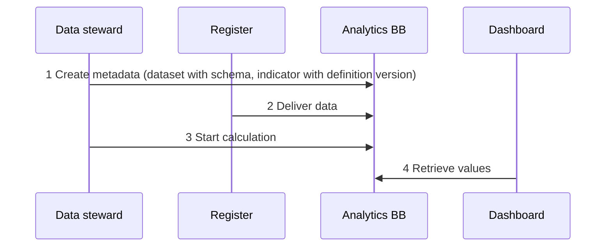
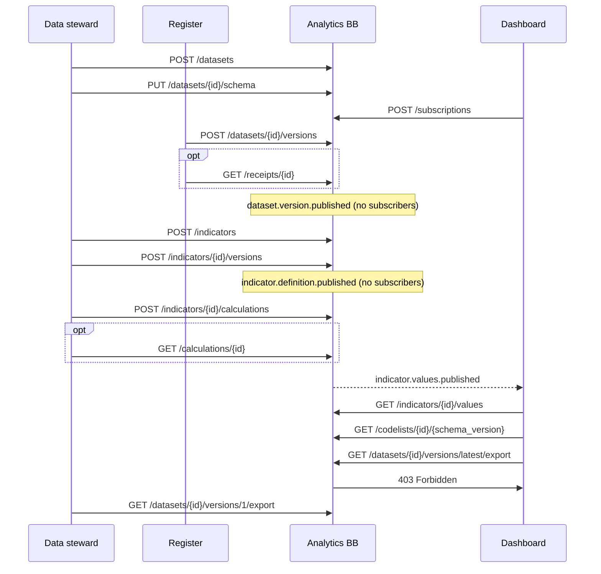
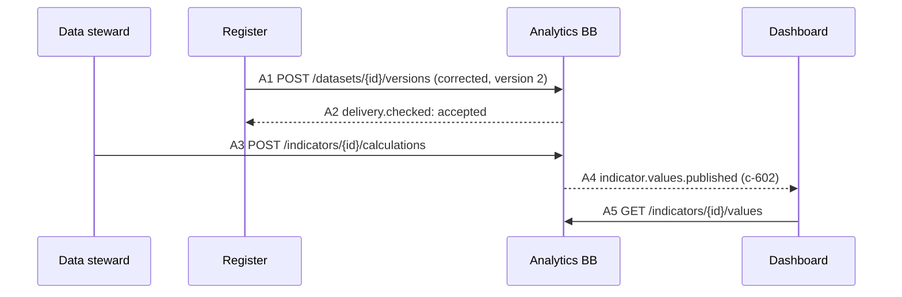
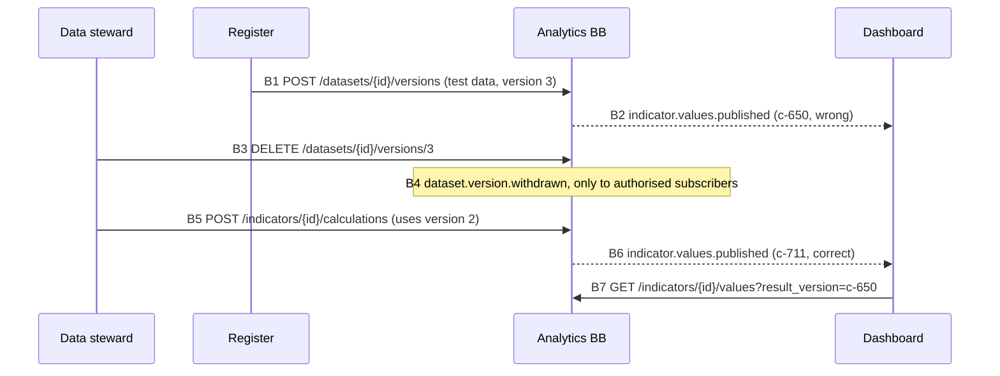

# 9 Internal Workflows

This section describes the workflows the Analytics Building Block supports, using only the operations of the core interface ([Section 8](8-service-apis.md)). They follow one continuous example: a labour market register delivers the labour force and the number of unemployed persons per region and year; the building block calculates the unemployment rate from it; and the dashboard of a regional administration displays it. All names, addresses and values are fictitious.

Each workflow refers to the functionality whose requirements it exercises. Event types are written without the prefix `org.govstack.analytics`; every request carries a bearer token (omitted in the examples).

| Participant | Role |
| ----------- | ---- |
| Data steward | Statistics unit responsible for the dataset and the indicator |
| Register | Supplying system: the labour market register |
| Analytics BB | The building block |
| Dashboard | Consuming and subscribing system of a regional administration; may read the indicator but not the underlying dataset |

## 9.1 Overview

At its core there are four steps: the data stewards describe what arrives and what is calculated from it; the register delivers the data; the calculation produces the indicator values; the dashboard retrieves them. The order of defining the indicator and the first delivery is free.



The complete flow in detail:



## 9.2 Register a dataset and its schema

Functionality: [Data Catalogue](requirements/data-catalogue.md)

Before the register can deliver, the dataset must exist in the catalogue. The building block sets the origin itself (`ORIGINAL` for everything that is delivered). The schema is a Table Schema according to Data Package Standard 2.0; every delivery is validated against it. The permitted codes for `region` are stated with their labels in `categories`; the building block generates the code list from them. This schema is schema version 1.

```http
POST /datasets
Content-Type: application/json

{ "dataset_id": "labour_market_regional",
  "title": "Labour force and unemployed persons by region",
  "publisher": "Regional Labour Office" }

→ 201 Created, Location: /datasets/labour_market_regional
```

```http
PUT /datasets/labour_market_regional/schema
Content-Type: application/json

{ "$schema": "https://datapackage.org/profiles/2.0/tableschema.json",
  "fields": [
    { "name": "region", "type": "string",
      "categories": [ { "value": "R01", "label": "North region" },
                      { "value": "R02", "label": "South region" } ] },
    { "name": "year", "type": "year" },
    { "name": "labour_force", "type": "integer" },
    { "name": "unemployed", "type": "integer" } ],
  "primaryKey": ["region", "year"] }

→ 204 No Content
```

By convention, `region` and `year` are identifiers (key fields), `year` is the time (key field with a time type), and `labour_force` and `unemployed` are measures.

## 9.3 Subscribe to events

Functionality: [Publication Events](requirements/publication-events.md)

The dashboard wants to be informed as soon as new values are available. The subscription is bound to the authenticated caller; the building block assigns its identifier, which the dashboard needs to unsubscribe later with `DELETE /subscriptions/sub-0815`. A validation request to the callback endpoint before events are sent there is recommended.

```http
POST /subscriptions
Content-Type: application/json

{ "types": ["org.govstack.analytics.indicator.values.published"],
  "sink": "https://dashboard.region.example/hooks/analytics",
  "protocol": "HTTP" }

→ 201 Created, Location: /subscriptions/sub-0815
```

## 9.4 Deliver a dataset version

Functionality: [Data Ingestion](requirements/data-ingestion.md)

The register delivers a Data Package with one CSV file in UTF-8. It can retrieve the schema beforehand with `GET /datasets/labour_market_regional/schema`. The `Idempotency-Key` prevents a duplicate version if the delivery is repeated after a network error.

```http
POST /datasets/labour_market_regional/versions
Idempotency-Key: 7c1e2f9a-2026-09-30-001
Content-Type: multipart/form-data; boundary=x

--x
Content-Disposition: form-data; name="datapackage.json"
Content-Type: application/json

{ "$schema": "https://datapackage.org/profiles/2.0/datapackage.json",
  "name": "labour-market-regional-2024",
  "resources": [ { "name": "labour_market_regional", "type": "table",
                   "path": "labour_market_regional.csv",
                   "format": "csv", "encoding": "utf-8" } ] }
--x
Content-Disposition: form-data; name="labour_market_regional.csv"
Content-Type: text/csv; charset=utf-8

region,year,labour_force,unemployed
R01,2023,1200000,46800
R01,2024,1190000,49980
R02,2023,980000,33320
R02,2024,985000,36445
--x--

→ 202 Accepted, Location: /receipts/q-4711
  { "receipt_id": "q-4711", "status": "validating" }
```

Querying the receipt is optional. The building block validates the delivery, creates the dataset version and sends its events whether or not the register ever asks. The query only informs the register, for example for its own transmission log. A system that can receive events subscribes to `delivery.checked` instead.

```http
GET /receipts/q-4711

→ 200 OK
  { "receipt_id": "q-4711", "status": "accepted",
    "dataset_id": "labour_market_regional", "version": 1,
    "checksum": "sha256:9f2c…e41a", "received_at": "2026-09-30T07:58:12Z",
    "href": "/datasets/labour_market_regional/versions/1" }
```

The building block now sends `dataset.version.published` and, if it offers the recommended event, `delivery.checked` to authorised subscribers of these types. In the example nobody has subscribed to them.

## 9.5 Define and publish an indicator

Functionality: [Indicator Calculation](requirements/indicator-calculation.md)

The data stewards create the indicator and then its definition version. Creating the definition version publishes it; from then on it is immutable. The request states neither dimensions, code lists, frequency nor input datasets: the building block determines the dimensions (`region` and the time) and the input dataset (`labour_market_regional`) from the calculation, generates the code list for `region` from the Table Schema, and derives the frequency from the time format.

```http
POST /indicators
Content-Type: application/json

{ "indicator_id": "ur", "title": "Unemployment rate" }

→ 201 Created, Location: /indicators/ur
```

```http
POST /indicators/ur/versions
Content-Type: application/json

{ "definition_version": "2",
  "unit": "%",
  "calculation": {
    "language": "vtl-2.1",
    "expression": "ur := labour_market_regional [calc ur := round(unemployed / labour_force * 100, 1)] [keep ur];" } }

→ 201 Created, Location: /indicators/ur/versions/2
```

The building block announces `indicator.definition.published`; in the example nobody has subscribed to it. A definition in a language the building block cannot execute is rejected.


The exact VTL syntax of the example is to be checked against the VTL reference manual before use.


## 9.6 Calculate an indicator

Functionality: [Indicator Calculation](requirements/indicator-calculation.md)

A calculation can take time. The building block accepts the request, answers immediately with an identifier and calculates in the background with the latest valid dataset version. The result is a new result version with its own provenance record; calculation, result version and provenance record share the identifier `c-501`. Calculations can also be started by the Scheduler BB with the same operation.

```http
POST /indicators/ur/calculations
Content-Type: application/json

{ "definition_version": "2" }

→ 202 Accepted, Location: /calculations/c-501
  { "calculation_id": "c-501", "status": "running" }
```

Querying the status is optional; subscribers learn about the completion through `indicator.values.published`, about a failure through `indicator.calculation.failed`. Anyone who knows a result version can retrieve its provenance record.

```http
GET /calculations/c-501

→ 200 OK
  { "calculation_id": "c-501", "indicator_id": "ur", "definition_version": "2",
    "status": "succeeded", "finished_at": "2026-09-30T08:00:00Z" }
```

```http
GET /lineage/c-501

→ 200 OK, Content-Type: application/ld+json
  { "@context": { "prov": "http://www.w3.org/ns/prov#" },
    "@id": "urn:analytics:calculation:c-501",
    "@type": "prov:Activity",
    "prov:used": [ { "@id": "urn:analytics:dataset_version:labour_market_regional:1",
                     "checksum": "sha256:9f2c…e41a" } ],
    "prov:qualifiedAssociation": { "prov:hadPlan": { "@id": "urn:analytics:indicator:ur:2" } },
    "prov:generated": { "@id": "urn:analytics:result_version:c-501" },
    "prov:endedAtTime": "2026-09-30T08:00:00Z" }
```

The building block then notifies the dashboard. The event contains only identifiers, no values, and only goes to subscribers that may read the indicator.

```http
POST https://dashboard.region.example/hooks/analytics
Content-Type: application/cloudevents+json

{ "specversion": "1.0",
  "type": "org.govstack.analytics.indicator.values.published",
  "source": "https://analytics.region.example/",
  "id": "evt-7781",
  "time": "2026-09-30T08:00:05Z",
  "subject": "indicators/ur",
  "datacontenttype": "application/json",
  "data": { "indicator_id": "ur", "definition_version": "2", "result_version": "c-501" } }
```

## 9.7 Retrieve values

Functionality: [Data Access](requirements/data-access.md)

Only the query without filters is mandatory: `GET /indicators/ur/values` returns all values of the current result version. Filters as in this example are recommended; a building block without filters rejects them with an error according to RFC 9457. Without a format parameter the values API answers with JSON-stat; with `format=csv` the same answer comes as CSV in long format.

```http
GET /indicators/ur/values?c[region]=R01,R02&c[time_period]=2023,2024

→ 200 OK, Content-Type: application/json
  { "version": "2.0", "class": "dataset", "label": "Unemployment rate",
    "id": ["region", "time_period"], "size": [2, 2],
    "role": { "time": ["time_period"], "geo": ["region"] },
    "updated": "2026-09-30T08:00:00Z",
    "dimension": {
      "region": { "href": "https://analytics.region.example/codelists/labour_market_regional.region/1",
                  "category": { "index": ["R01", "R02"] } },
      "time_period": { "category": { "index": ["2023", "2024"] } } },
    "value": [3.9, 4.2, 3.4, 3.7],
    "status": { "1": "P", "3": "P" },
    "extension": { "indicator_id": "ur", "definition_version": "2",
                   "result_version": "c-501", "unit": "%", "based_on_withdrawn": false } }
```

The response refers to the code list `labour_market_regional.region` in version 1 for the labels. The dashboard retrieves it once and caches it.

```http
GET /codelists/labour_market_regional.region/1

→ 200 OK
  { "version": "2.0", "class": "dimension",
    "href": "https://analytics.region.example/codelists/labour_market_regional.region/1",
    "label": "region",
    "category": { "index": ["R01", "R02"],
                  "label": { "R01": "North region", "R02": "South region" } } }
```

### Export of the underlying data

The dashboard may read the rate but not the underlying dataset; this is set by the access management of the platform. Its attempt to export the raw data is rejected. The data stewards' role may read the dataset, so the same export succeeds for them, and its content corresponds exactly to the delivered version.

```http
GET /datasets/labour_market_regional/versions/latest/export?format=csv   (dashboard)

→ 403 Forbidden, Content-Type: application/problem+json
  { "type": "https://analytics.region.example/problems/forbidden",
    "title": "No read permission", "status": 403,
    "detail": "The caller may not read the dataset labour_market_regional.",
    "instance": "/datasets/labour_market_regional/versions/latest/export" }
```

```http
GET /datasets/labour_market_regional/versions/1/export?format=csv   (data steward)

→ 200 OK, Content-Type: text/csv; charset=utf-8
  Content-Disposition: attachment; filename="labour_market_regional_1.csv"
  region,year,labour_force,unemployed
  R01,2023,1200000,46800
  …
```

## 9.8 Correct a delivery

Functionality: [Data Ingestion](requirements/data-ingestion.md), [Indicator Calculation](requirements/indicator-calculation.md)

Dataset versions are immutable, so faulty deliveries are handled in one of two ways. This one applies when the data is wrong but harmless. The register notices that for R01 in 2024 the unemployed were counted at the wrong reference date: 49,980 instead of 48,790. A corrected delivery is sufficient; the old version remains part of the history. In this example the register has subscribed to `delivery.checked`.



1. **A1 Corrected delivery.** The register delivers the complete, corrected state with a new `Idempotency-Key`. The building block validates it like any delivery and accepts it as version 2.
2. **A2 Acceptance.** Instead of querying the receipt, the register receives the result as `delivery.checked`. This event always goes to the supplying system, even if it may not read the dataset. In parallel, the building block sends `dataset.version.published` to authorised subscribers.
3. **A3 Calculation.** The definition remains unchanged; only the data is new. The calculation uses the latest valid version, i.e. version 2, and produces the result version `c-602`. Whether someone starts it or the building block calculates automatically on new data is up to the installation.
4. **A4 Notification.** The dashboard receives the same event as in 9.6, with the new result version.
5. **A5 Corrected values.** Without a result version, the new one is returned: 4.1 instead of 4.2 for R01 in 2024. With `result_version=c-501` the old state remains retrievable, and version 1 of the dataset is still listed with the status `valid`. It was corrected, not discarded.

## 9.9 Withdraw a delivery

Functionality: [Data Ingestion](requirements/data-ingestion.md), [Data Access](requirements/data-access.md)

This way applies to data that should never have arrived. A week later the register accidentally delivers test data from its acceptance system. It fits the schema and is accepted; the installation calculates automatically on new data, and the dashboard suddenly shows 8.4 % for R01. This data must not remain in the system. The same applies if the wrong dataset or personal data was delivered by mistake.



1. **B1 Test data delivered.** The delivery is formally correct and is accepted as version 3. The error lies in the content, not the form, so schema validation cannot detect it.
2. **B2 Wrong values announced.** The automatic calculation produces the result version `c-650` with 8.4 % for R01 in 2024, and the dashboard is notified.
3. **B3 Withdrawal.** The data stewards notice the error and withdraw version 3 with a reason. The building block deletes the content and keeps the metadata, so that provenance records remain resolvable. The register itself could not withdraw; it would receive `403 Forbidden`.
   ```http
   DELETE /datasets/labour_market_regional/versions/3
   Content-Type: application/json

   { "reason": "Test data from the acceptance system delivered by mistake" }

   → 200 OK
     { "dataset_id": "labour_market_regional", "version": 3, "status": "withdrawn",
       "reason": "Test data from the acceptance system delivered by mistake",
       "withdrawn_at": "2026-10-20T14:05:00Z", … }
   ```
4. **B4 Withdrawal announced.** `dataset.version.withdrawn` only goes to subscribers that may read the dataset. The dashboard may not, so it does not receive it; it learns about the correction through the new values in B6.
5. **B5 Recalculation.** The withdrawn version is skipped; `latest` points to version 2 again. The new calculation `c-711` restores the correct state, and its provenance record shows that it is based on version 2.
6. **B6 Correct values announced.** The dashboard reloads and shows 4.1 % for R01 in 2024 again.
7. **B7 Faulty result version checked.** The faulty result version remains retrievable, so that it is traceable what was displayed in the meantime. It is marked, so a client sees immediately that it cannot trust these figures:
   ```http
   GET /indicators/ur/values?result_version=c-650&c[region]=R01

   → 200 OK
     { "version": "2.0", "class": "dataset", "value": [3.9, 8.4],
       "extension": { "result_version": "c-650", "based_on_withdrawn": true, … } }
   ```

**The difference at a glance:** with a correction, the old dataset version remains valid and complete; it is just no longer the latest. With a withdrawal, its content disappears, the metadata remain with the reason, and everything based on it is marked.

## 9.10 Open points


* **Signature method for events.** The specification requires events to be signed but does not yet name a method. The requirement only becomes testable once a method is defined.
* **Transfer of the Data Package.** The examples use a multipart request; whether a ZIP archive or references to files are also allowed is not yet decided.
* **Access control.** The workflows only assume that the dashboard may read the indicator but not the dataset. Whether this is governed by access classes of the building block or by the platform alone is an open decision.

